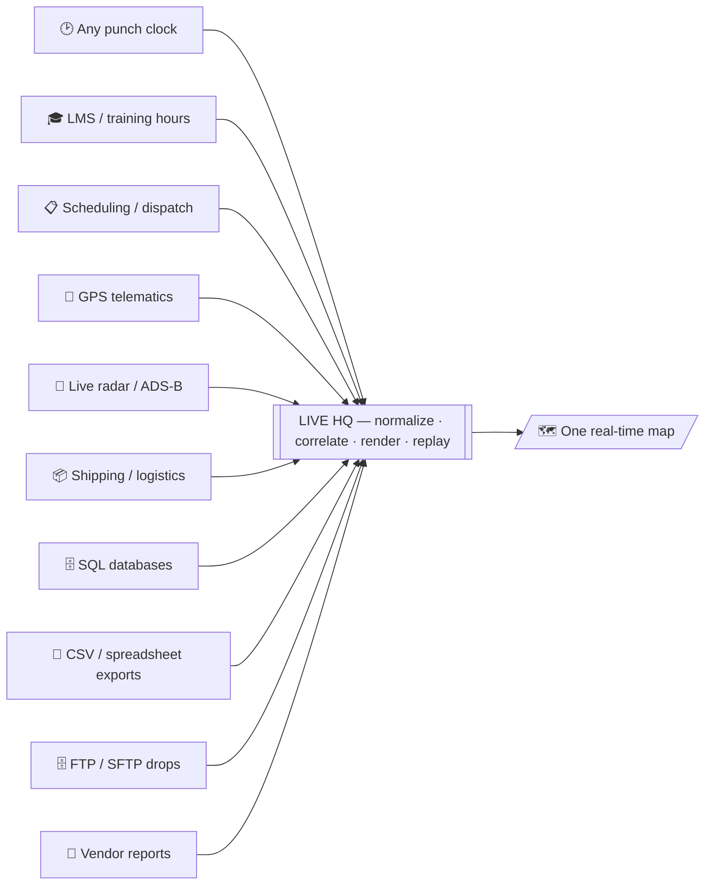

# Live Operations HQ

**One system to see everything move.**

Give a business any source it runs on — a punch-in/out clock, an LMS or training-hours system, scheduling & dispatch, GPS trackers, live radar, shipping & logistics, moving-parts & asset tracking, IoT sensors — and this turns them into **one real-time visual command center** that anyone can read at a glance: who's on-site, what's active, where every asset is, right now.

This repo is a **working, anonymized demo** of a real production system. It runs offline — all data is baked in and synthetic (names, identifiers and locations are fake).

| Page | What it is |
|---|---|
| `index.html` | The showcase — start here. |
| `presentation.html` | The production ops map on its own. |
| `pipeline.html` | **Any source → the same map.** Pick a CSV / FTP drop / spreadsheet / vendor report / JSON API / SQL export, then pick a business type. The engine reads the format, works out what each column means, and renders the rows as people, vehicles, aircraft or assets on that layout. |
| `studio.html` | **The tool.** Load your own file, confirm the field mapping, and *promote* the source — which writes a connector manifest (endpoint, refresh interval, field mapping, area routing) the HQ runs on a schedule. Files are parsed in the browser and never uploaded. |

> **Live demo:** host this folder on GitHub Pages and share the link.

## What the demo shows

A top-down operations map rendered live from several sources at once:

- **People** placed by role and moving around their areas — from a time-&-attendance (punch-clock) source.
- **Aircraft** flying a traffic-pattern loop, tagged **DUAL / SOLO** — from scheduling/dispatch, confirmed by a live **ADS-B radar** feed.
- **Vehicles** parked in a lot (one drives in) — from a **GPS telematics API**, with "at base" decided by a geofence.
- **Click** any person, aircraft or vehicle for detail; **search** by name or tail; hit **⏱ Replay day** to scrub the whole day from history.

## Any source, not just live feeds

Most operations already emit the data — it just arrives as files nobody looks at. The engine in `pipeline.html` / `studio.html` takes those as they are:

- **Formats** — comma, semicolon, tab or pipe delimited; quoted fields; nested JSON flattened one level; `NULL` / `N/A` / `—` treated as empty; currency symbols, thousands separators and percentages read as numbers.
- **Vendor reports** — a header buried under title and account lines is found by taking the widest row; footers are dropped.
- **Column meaning** — each column typed (date / number / category / boolean / text) with distinct counts and fill rate, then the *label*, *area* and *state* fields inferred from both column names and the values themselves.
- **Your layout** — four site plans ship in the demo (airfield, warehouse, construction site, fleet depot). The file's own location values are matched to your area names where they match, assigned to free areas where they don't, and the routing is shown so an operator can override it.
- **Promote** — the confirmed mapping is written as a connector manifest. Adding a source is a manifest, not a code change.

## Architecture

Every source is reached through one small endpoint that returns normalized JSON; the map only consumes those, so connecting a new system never changes the rendering.

## Connect a real source

In the demo, the map's data calls are intercepted and served from baked-in anonymized snapshots (so it runs offline). In production each call hits a small endpoint — e.g. `attendance`, `dispatch`, `vehicles` — that returns the same JSON shape from the real system. To wire a new source you add one endpoint that returns that shape; the UI is unchanged. Secrets (like a GPS API key) stay on a server-side proxy that mints short-lived tokens, so the browser never holds one.

## Tech

`PHP` · `JavaScript` · `HTML5 Canvas` · `MySQL` · `REST / JSON` · `Token auth (JWT)` · `GPS telematics` · `ADS-B` · `Real-time polling` · `CSV / TSV / pipe / JSON parsing` · `Schema inference` · `Field mapping` · `Role- & site-scoped access control` · zero front-end dependencies.

## About

Built by **Lazaro** — integration & data-visualization engineer. _Add your email / portfolio link here._

MIT License — see [LICENSE](LICENSE). All data in this repo is synthetic.
