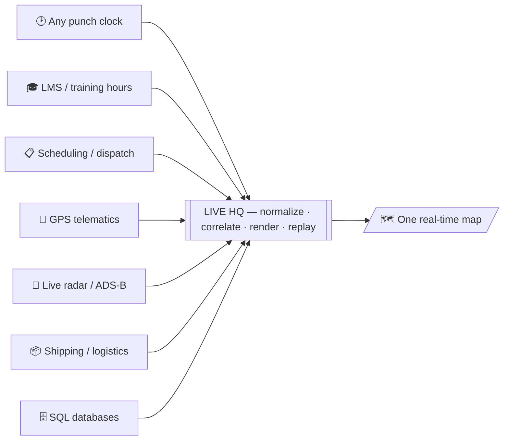

# Live Operations HQ

**One system to see everything move.**

Give a business any source it runs on — a punch-in/out clock, an LMS or training-hours system, scheduling & dispatch, GPS trackers, live radar, shipping & logistics, moving-parts & asset tracking, IoT sensors — and this turns them into **one real-time visual command center** that anyone can read at a glance: who's on-site, what's active, where every asset is, right now.

This repo is a **working, anonymized demo** of a real production system. Open `index.html` for the showcase page, or `presentation.html` for the map by itself. It runs offline — all data is baked in and synthetic (names, identifiers and locations are fake).

> **Live demo:** host this folder on GitHub Pages and share the link.

## What the demo shows

A top-down operations map rendered live from several sources at once:

- **People** placed by role and moving around their areas — from a time-&-attendance (punch-clock) source.
- **Aircraft** flying a traffic-pattern loop, tagged **DUAL / SOLO** — from scheduling/dispatch, confirmed by a live **ADS-B radar** feed.
- **Vehicles** parked in a lot (one drives in) — from a **GPS telematics API**, with "at base" decided by a geofence.
- **Click** any person, aircraft or vehicle for detail; **search** by name or tail; hit **⏱ Replay day** to scrub the whole day from history.

## Architecture

Every source is reached through one small endpoint that returns normalized JSON; the map only consumes those, so connecting a new system never changes the rendering.

## Connect a real source

In the demo, the map's data calls are intercepted and served from baked-in anonymized snapshots (so it runs offline). In production each call hits a small endpoint — e.g. `attendance`, `dispatch`, `vehicles` — that returns the same JSON shape from the real system. To wire a new source you add one endpoint that returns that shape; the UI is unchanged. Secrets (like a GPS API key) stay on a server-side proxy that mints short-lived tokens, so the browser never holds one.

## Tech

`PHP` · `JavaScript` · `HTML5 Canvas` · `MySQL` · `REST / JSON` · `Token auth (JWT)` · `GPS telematics` · `ADS-B` · `Real-time polling` · `Role- & site-scoped access control` · zero front-end dependencies.

## About

Built by **Lazaro** — integration & data-visualization engineer. _Add your email / portfolio link here._

MIT License — see [LICENSE](LICENSE). All data in this repo is synthetic.
